# Rain_DB - Diagnóstico de Câncer de Mama com Machine Learning

**Tech Challenge — Fase 1 · PÓS TECH**

---

## 1. O problema

- Um hospital universitário precisa **acelerar a triagem de exames** sem perder qualidade.
- Objetivo: classificar tumores de mama como **benignos** ou **malignos**.
- O sistema é uma **ferramenta de apoio**: a decisão final é sempre do médico.

**Duas abordagens:**

| Parte | Dados | Técnica |
|---|---|---|
| Principal | 30 medidas das células do tumor (tabela) | Regressão Logística e Random Forest |
| Extra | Imagens de mamografia | Rede neural convolucional (CNN) |

---

## 2. Dataset — Breast Cancer Wisconsin

| Característica | Valor |
|---|---|
| Pacientes | 569 |
| Variáveis | 30 medidas numéricas |
| Benignos | 357 (62,7%) |
| Malignos | 212 (37,3%) |
| Valores ausentes | Nenhum |

**10 medidas × 3 versões:**
- Medidas: raio, textura, perímetro, área, suavidade, compacidade, concavidade, pontos côncavos, simetria e dimensão fractal.
- Versões: `_mean` (média), `_se` (erro padrão) e `_worst` (os piores valores).

---

## 3. Estrutura do projeto

```
Rain_DB/
├── data/data.csv           → dataset
├── main.py                 → pipeline completo
├── notebooks/              → parte extra (CNN no Colab)
├── outputs/                → gráficos e resultados
├── Dockerfile              → execução em container
├── requirements.txt        → dependências
└── README.md               → documentação
```

**Pipeline do `main.py`:**

1. `load_data` → carrega e limpa os dados
2. `perform_eda` → estatísticas e gráficos
3. `split_data` → treino, validação e teste
4. `build_models` → cria os dois modelos
5. `train_and_select_model` → treina e escolhe o melhor
6. `evaluate_model` → métricas no teste
7. `analyze_feature_importance` e `analyze_with_shap` → interpretação

**Execução com um único comando:**

```bash
docker run --rm -v "${PWD}/outputs:/app/outputs" tech-challenge
```

---

## 4. Análise exploratória

### Correlação com o diagnóstico

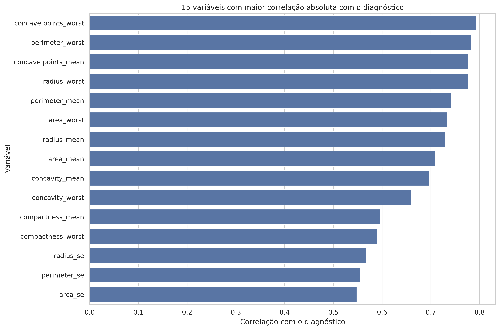

- As medidas mais ligadas à malignidade são as de **tamanho** (perímetro, raio, área) e as de **concavidade**.
- `concave points_worst` tem correlação de **0,79** com o diagnóstico.

### Distribuição do raio médio

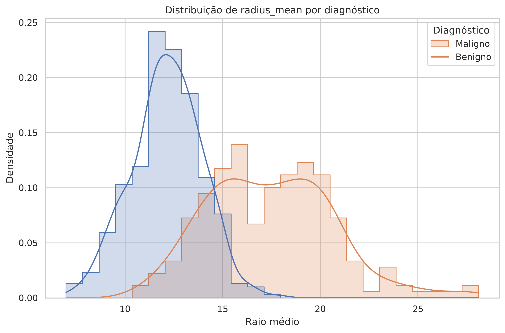

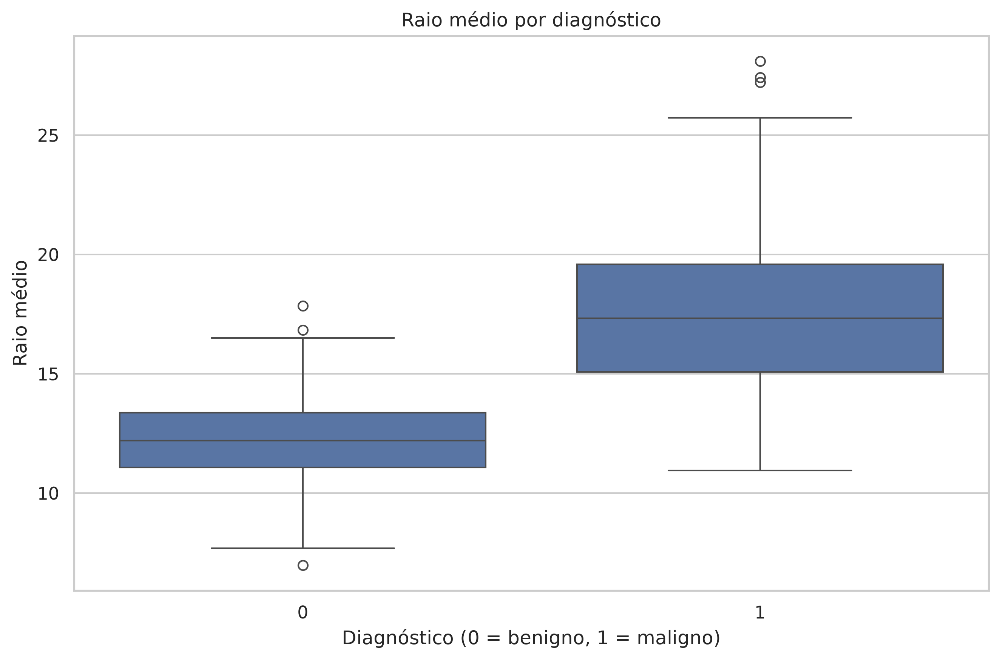

- Os tumores malignos são **claramente maiores**.
- Existe uma **zona de sobreposição** (raio entre 13 e 16), onde uma única medida não basta para decidir.

### Pré-processamento

- Foram removidas as colunas `id` e `Unnamed: 32`, que estava vazia.
- O diagnóstico foi codificado assim: **B → 0** e **M → 1**.
- `StandardScaler` foi usado na Regressão Logística, **dentro do pipeline**, para evitar vazamento de dados.

---

## 5. Separação dos dados

| Conjunto | Proporção | Registros | Uso |
|---|---|---|---|
| Treino | 60% | 341 | O modelo aprende |
| Validação | 20% | 114 | Escolha do melhor modelo |
| Teste | 20% | 114 | Avaliação final, usado uma única vez |

A separação é **estratificada**: cada conjunto mantém a mesma proporção de benignos e malignos.

---

## 6. Modelos e métrica

| Modelo | Característica |
|---|---|
| **Regressão Logística** | Linear, simples e interpretável |
| **Random Forest** | 200 árvores e captura relações não lineares |

### Por que o recall?

| Erro | Consequência |
|---|---|
| **Falso negativo** (maligno → benigno) | A paciente fica sem tratamento. **É o erro mais grave.** |
| Falso positivo (benigno → maligno) | Exames extras e biópsia |

➡️ O modelo foi escolhido pelo **recall da classe maligna**, ou seja, quantos casos malignos ele encontra.

| Modelo | Recall na validação |
|---|---|
| **Regressão Logística** ✅ | **97,7%** |
| Random Forest | 95,3% |

---

## 7. Resultados no teste — Regressão Logística

| Métrica | Valor |
|---|---|
| Acurácia | **97,4%** |
| Recall (maligno) | **95,2%** |
| Precisão (maligno) | 97,6% |
| F1-score (maligno) | 96,4% |

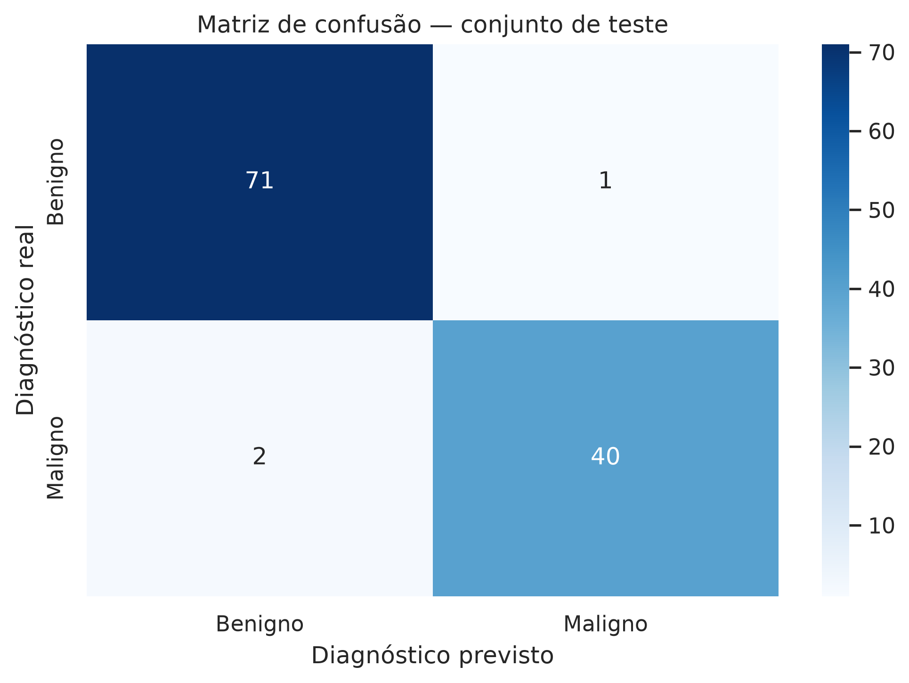

- O modelo encontrou **40 de 42** tumores malignos.
- Errou 3 casos em 114: **2 falsos negativos** e 1 falso positivo.

---

## 8. Interpretação do modelo

### SHAP — visão geral

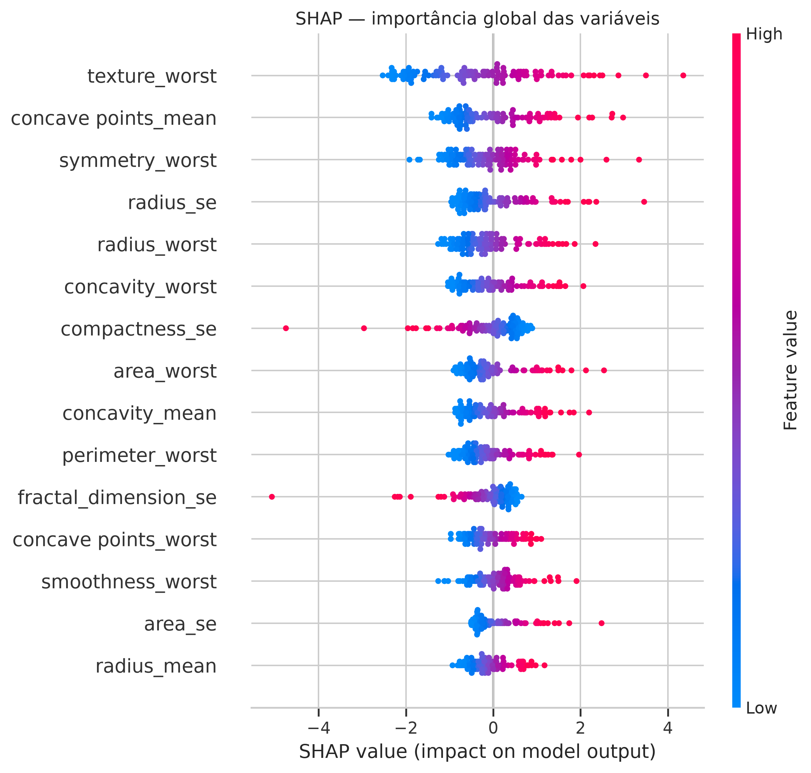

- Cada ponto é um paciente. **Vermelho** indica valor alto e **azul**, valor baixo.
- Pontos à direita empurram a previsão para **maligno**.
- Variáveis de maior impacto: `texture_worst`, `concave points_mean`, `symmetry_worst`, `radius_se` e `radius_worst`.

### SHAP — explicação de um paciente

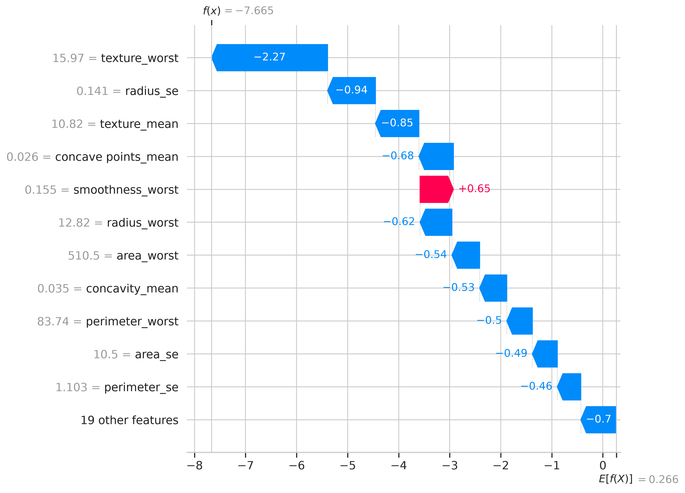

- O gráfico mostra **por que** o modelo deu aquela resposta para aquele paciente.
- Com isso, o médico pode **conferir e discordar** do modelo.

### Feature importance — Random Forest

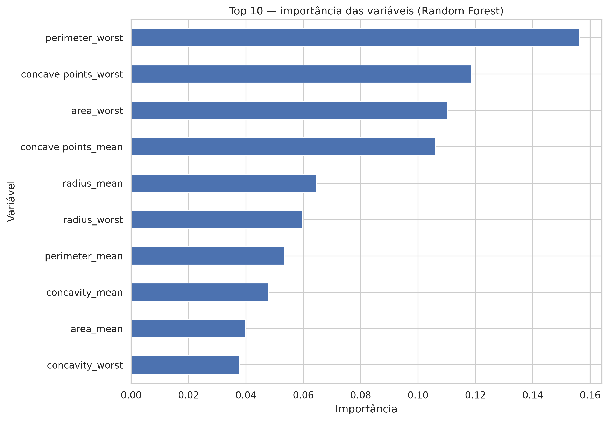

- No topo: `perimeter_worst`, `concave points_worst` e `area_worst`.
- O ranking é diferente do SHAP porque os **modelos são diferentes** e porque **raio, perímetro e área são redundantes**.
- Mesmo assim, os dois concordam: **tamanho e concavidade** são os sinais principais.

---

## 9. Extra — CNN com mamografias (CBIS-DDSM)

### Dados

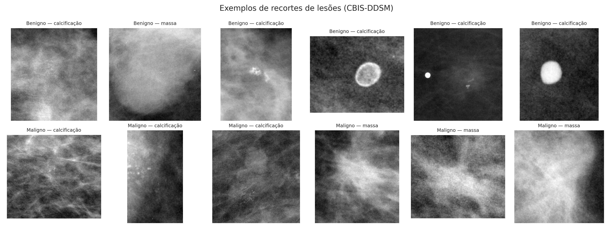

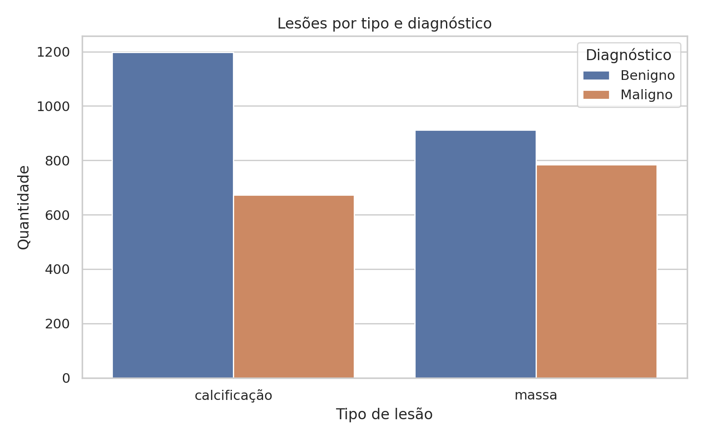

| Conjunto | Imagens | Malignos |
|---|---|---|
| Treino | 2.277 | 41,2% |
| Validação | 585 | 41,5% |
| Teste | 704 | 39,2% |

- São 3.566 **recortes de lesões** (massas e calcificações).
- Treino e validação foram **separados por paciente**.

### Modelo

- *Transfer learning* com a **EfficientNetB0**, pré-treinada no ImageNet.
- Imagens de 224×224, com aumento de dados (giros, rotação, zoom e contraste).
- Treino em 2 fases: primeiro o classificador e depois o ajuste fino das últimas 40 camadas.
- Executado no **Google Colab com GPU T4**.

### Treinamento

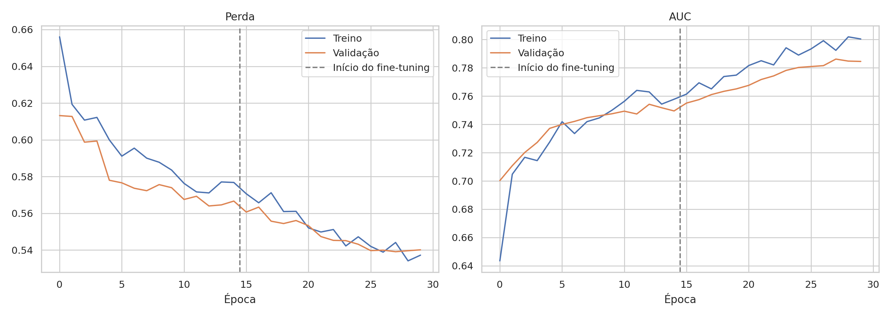

- Treino e validação andam juntos, ou seja, **não houve overfitting**.
- A AUC de validação **ainda subia** no final, então mais treino pode melhorar o resultado.

### Resultados no teste

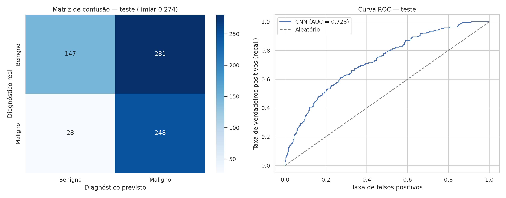

**AUC: 0,73**

| Limiar | Acurácia | Precisão | Recall | F1 |
|---|---|---|---|---|
| 0,5 (padrão) | 68,9% | 62,1% | 52,9% | 57,1% |
| **0,274 (ajustado)** | 56,1% | 46,9% | **89,9%** | **61,6%** |

- Com o limiar ajustado, a rede encontra **248 de 276** lesões malignas.
- O custo: **281 de 428** benignos marcados como suspeitos.

### Grad-CAM — onde a rede olha

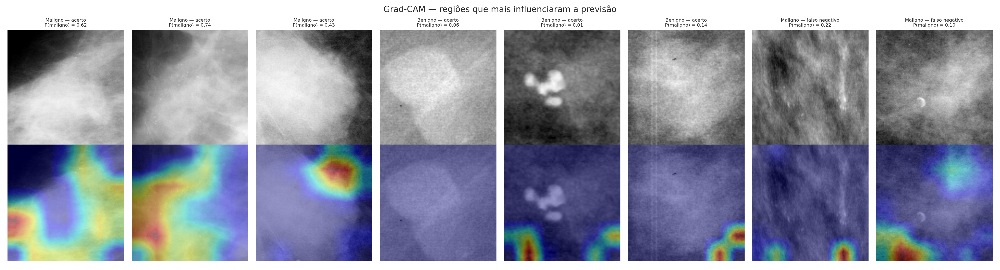

- Em alguns casos, a rede **foca na lesão**.
- Em outros, inclusive nos erros, ela **foca nas bordas do recorte**.
- Conclusão: a CNN **ainda não é confiável** para uso clínico.

---

## 10. Comparação e discussão

| Aspecto | Modelo tabular | CNN com imagens |
|---|---|---|
| Entrada | 30 medidas já extraídas | Recorte da mamografia |
| Recall (maligno) | **95,2%** | 89,9% |
| Falsos positivos | 1 em 72 | 281 em 428 |
| Interpretação | SHAP coerente com a clínica | Grad-CAM às vezes fora da lesão |
| Prontidão | Pronto para validação externa | Precisa de mais trabalho |

**Por que a diferença?** O modelo tabular recebe medidas que especialistas já extraíram. A CNN precisa aprender sozinha o que observar.

### Uso na prática

1. **Triagem:** colocar no topo da fila os exames com maior chance de malignidade.
2. **Segunda leitura:** mostrar a probabilidade junto com a explicação (SHAP).
3. **Alerta de divergência:** sinalizar os casos em que o laudo e o modelo discordam.

### Limitações

- Dataset pequeno, vindo de uma única instituição. É preciso validar com dados externos.
- Mesmo com 95% de recall, **2 casos malignos** passaram.
- A CNN depende de recortes já marcados por um radiologista.

### Próximos passos

- Treinar a CNN por mais épocas e com imagens de maior resolução.
- Validar os dois modelos com dados de outros hospitais.

---

## Conclusão

- ✅ Pipeline completo e reproduzível com Docker.
- ✅ Modelo tabular com **97,4% de acurácia** e **95,2% de recall** para malignos.
- ✅ Previsões explicáveis com SHAP.
- ✅ Extra: CNN com mamografias (AUC de 0,73) e Grad-CAM.

> **O sistema apoia o médico, mas não o substitui. A palavra final é sempre do médico.**
