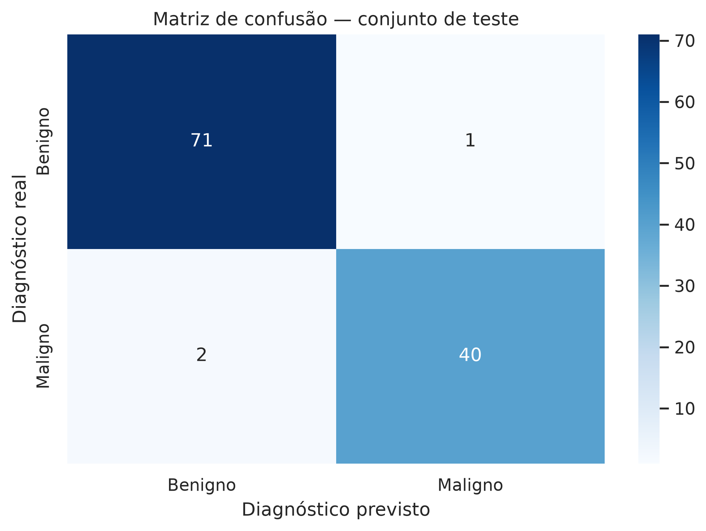
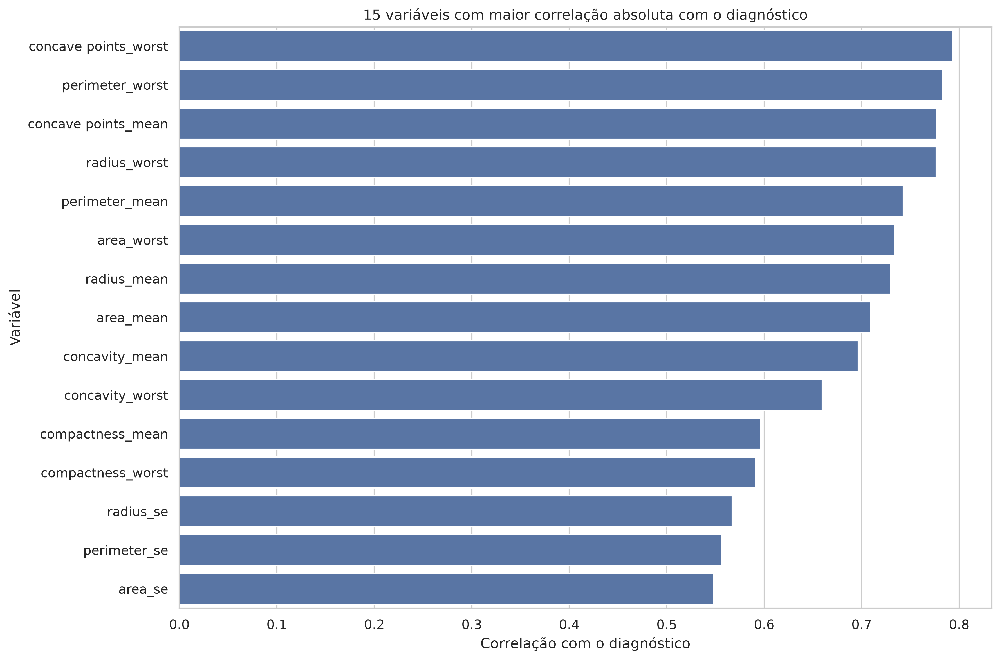
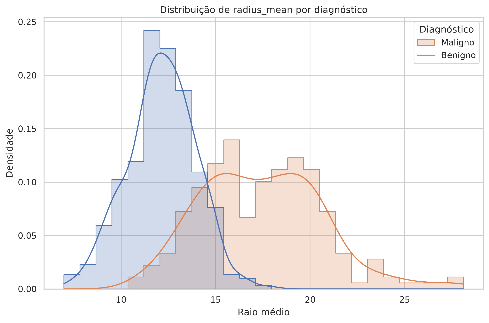
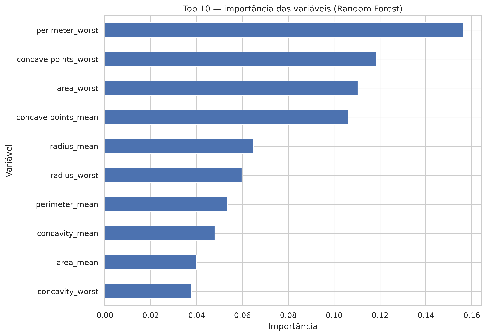
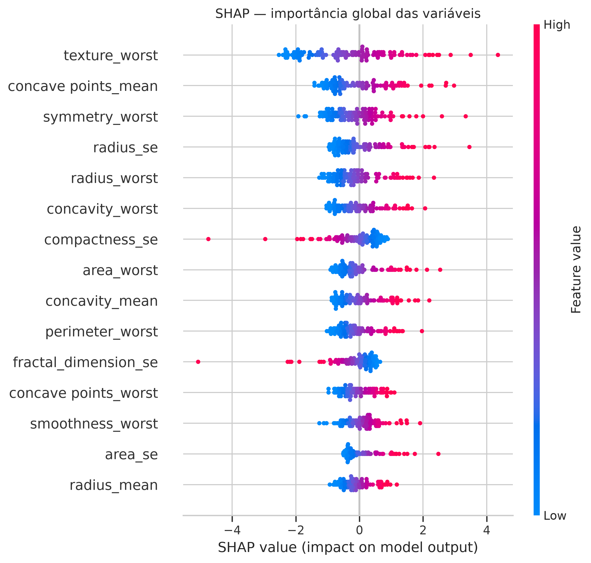
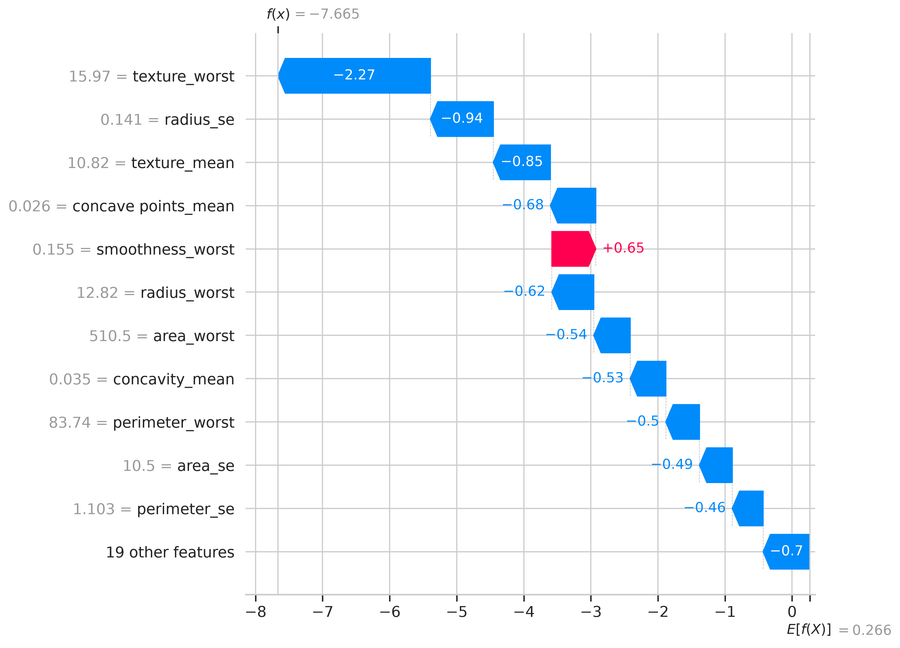
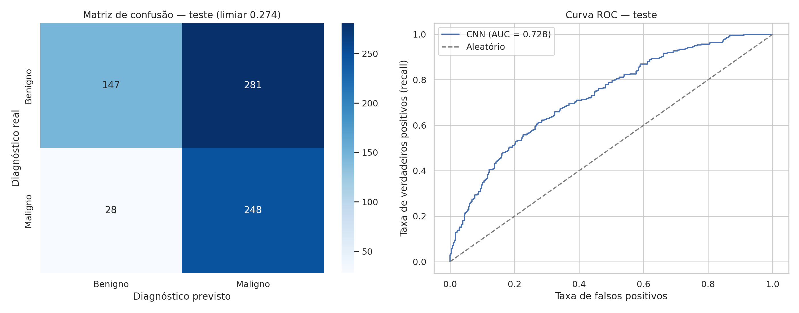
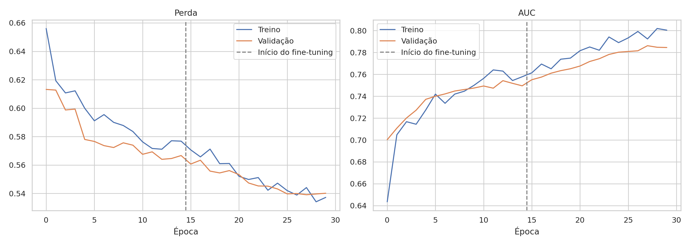
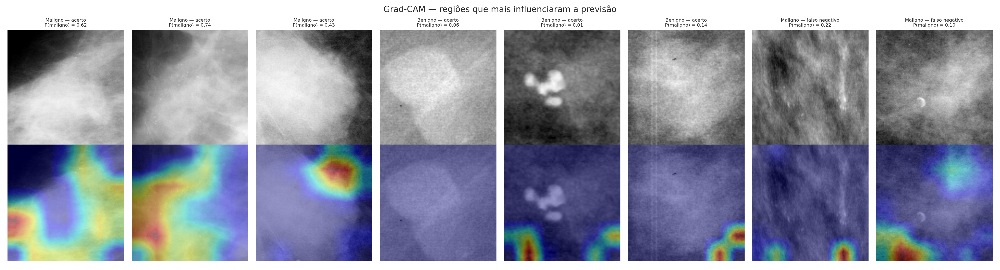

# Tech Challenge — Fase 1: Diagnóstico de Câncer de Mama com Machine Learning

Projeto desenvolvido para o Tech Challenge da Fase 1 da PÓS TECH.

O objetivo é construir a base de um sistema de **apoio ao diagnóstico** para um hospital universitário: a partir de medidas extraídas de exames de imagem de tumores de mama, um modelo de Machine Learning classifica o tumor como **benigno** ou **maligno**, destacando as informações que mais pesaram na decisão.

> ⚠️ Este sistema é uma ferramenta de **suporte** à decisão clínica. Ele não substitui o médico, que sempre tem a palavra final no diagnóstico.

---

## Sumário

- [Dataset](#dataset)
- [Estrutura do projeto](#estrutura-do-projeto)
- [Como executar](#como-executar)
- [Fluxo do pipeline](#fluxo-do-pipeline)
- [Resultados](#resultados)
- [Interpretação do modelo](#interpretação-do-modelo)
- [Extra: CNN com mamografias](#extra-cnn-com-mamografias-cbis-ddsm)
- [Limitações e uso na prática](#limitações-e-uso-na-prática)
- [Entregáveis](#entregáveis)
- [Autores](#autores)

---

## Dataset

**Breast Cancer Wisconsin (Diagnostic)**
Fonte: [Kaggle — uciml/breast-cancer-wisconsin-data](https://www.kaggle.com/datasets/uciml/breast-cancer-wisconsin-data/data)

| Característica | Valor |
|---|---|
| Registros (pacientes) | 569 |
| Variáveis preditoras | 30 (numéricas) |
| Variável alvo | `diagnosis` — B (benigno) / M (maligno) |
| Benignos | 357 (62,7%) |
| Malignos | 212 (37,3%) |
| Valores ausentes | Nenhum (exceto a coluna vazia `Unnamed: 32`, removida) |

As 30 variáveis descrevem os núcleos celulares de uma imagem digitalizada de punção aspirativa por agulha fina (PAAF). São 10 medidas (raio, textura, perímetro, área, suavidade, compacidade, concavidade, pontos côncavos, simetria e dimensão fractal), cada uma em três versões:

- `_mean`: valor médio;
- `_se`: erro padrão;
- `_worst`: média dos três maiores valores.

O arquivo já está incluído no repositório em `data/data.csv`. Caso precise baixá-lo novamente, salve-o nesse mesmo caminho.

---

## Estrutura do projeto

```
.
├── data/
│   └── data.csv            # Dataset
├── notebooks/
│   └── extraCnnCbisDdsm.ipynb  # Parte extra: CNN com mamografias (Google Colab)
├── outputs/                # Gráficos e resultados gerados pela execução
│   └── cnn/                # Resultados da parte extra
├── main.py                 # Pipeline completo (EDA → modelagem → avaliação → SHAP)
├── requirements.txt        # Dependências Python
├── Dockerfile              # Imagem para execução em container
├── .dockerignore
└── README.md
```

---

## Como executar

### Opção 1 — Docker (recomendado)

Pré-requisito: [Docker Desktop](https://www.docker.com/products/docker-desktop/) instalado e em execução.

```bash
# 1. Construir a imagem
docker build -t tech-challenge .

# 2. Executar o pipeline (os gráficos serão salvos na pasta outputs/ local)
docker run --rm -v "${PWD}/outputs:/app/outputs" tech-challenge
```

> No Prompt de Comando (cmd) do Windows, troque `${PWD}` por `%cd%`.

### Opção 2 — Ambiente local

Pré-requisito: Python 3.14.

```bash
# 1. Criar e ativar o ambiente virtual
python -m venv .venv

# Windows (PowerShell)
.venv\Scripts\Activate.ps1
# Linux / macOS
source .venv/bin/activate

# 2. Instalar as dependências
pip install -r requirements.txt

# 3. Executar
python main.py
```

A execução imprime no terminal as estatísticas, as métricas dos modelos e as variáveis mais importantes. Os gráficos são salvos em `outputs/`.

---

## Fluxo do pipeline

### 1. Carregamento e limpeza
- Leitura de `data/data.csv`.
- Remoção das colunas `id` (identificador, sem valor preditivo) e `Unnamed: 32` (totalmente vazia).
- Validação da coluna alvo e codificação: **B → 0** (benigno), **M → 1** (maligno).

### 2. Análise exploratória (EDA)
- Estatísticas descritivas de todas as variáveis.
- Correlação de cada variável com o diagnóstico.
- Histogramas e boxplot comparando benignos e malignos.

### 3. Separação dos dados
Divisão estratificada, que mantém a proporção de benignos e malignos em cada conjunto:

| Conjunto | Proporção | Registros | Uso |
|---|---|---|---|
| Treino | 60% | 341 | Ajuste dos modelos |
| Validação | 20% | 114 | Comparação e escolha do melhor modelo |
| Teste | 20% | 114 | Avaliação final (usado uma única vez) |

### 4. Modelagem
Dois modelos, cada um em um `Pipeline` do scikit-learn:

| Modelo | Pré-processamento | Por que foi escolhido |
|---|---|---|
| **Regressão Logística** | `StandardScaler` | Modelo linear, simples e interpretável; sensível à escala, por isso a padronização |
| **Random Forest** (200 árvores) | Nenhum | Captura relações não lineares; não depende da escala das variáveis |

O `StandardScaler` fica dentro do pipeline, então é ajustado **somente com os dados de treino**. Isso evita vazamento de informação para a validação e o teste.

### 5. Seleção do modelo
O critério é o **recall da classe maligna** no conjunto de validação.

Em diagnóstico de câncer, o erro mais grave é o **falso negativo**: classificar um tumor maligno como benigno, o que pode atrasar o tratamento. O recall mede exatamente a proporção de casos malignos que o modelo consegue identificar.

### 6. Avaliação e interpretação
- Métricas no conjunto de teste: acurácia, precisão, recall e F1-score.
- Matriz de confusão.
- Importância das variáveis (Random Forest).
- Valores SHAP do modelo selecionado: explicação global e explicação de um paciente individual.

---

## Resultados

### Comparação na validação

| Modelo | Recall (maligno) |
|---|---|
| **Regressão Logística** | **0,9767** |
| Random Forest | 0,9535 |

➡️ Modelo selecionado: **Regressão Logística**

### Desempenho final no teste

| Métrica | Valor |
|---|---|
| Acurácia | **97,37%** |
| Precisão (maligno) | 97,56% |
| Recall (maligno) | **95,24%** |
| F1-score (maligno) | 96,39% |

### Matriz de confusão (teste)

|  | Previsto benigno | Previsto maligno |
|---|---|---|
| **Real benigno** | 71 | 1 |
| **Real maligno** | 2 | 40 |

Dos 42 tumores malignos do conjunto de teste, o modelo identificou 40. Houve **2 falsos negativos** e **1 falso positivo**.



### Variáveis mais correlacionadas com o diagnóstico

| Variável | Correlação |
|---|---|
| concave points_worst | 0,794 |
| perimeter_worst | 0,783 |
| concave points_mean | 0,777 |
| radius_worst | 0,777 |
| perimeter_mean | 0,743 |





---

## Interpretação do modelo

### Importância das variáveis — Random Forest



As variáveis mais importantes foram `perimeter_worst`, `concave points_worst`, `area_worst` e `concave points_mean`, todas ligadas ao **tamanho** e ao **formato irregular** do tumor.

### SHAP — Regressão Logística (modelo selecionado)



As cinco variáveis de maior impacto médio foram `texture_worst`, `concave points_mean`, `symmetry_worst`, `radius_se` e `radius_worst`.

**Por que o ranking é diferente do Random Forest?**
- Os dois rankings explicam **modelos diferentes**.
- Variáveis como `radius`, `perimeter` e `area` são quase redundantes, porque todas medem o tamanho do tumor. A Regressão Logística divide o peso entre elas, e por isso cada uma, isoladamente, aparece com menos destaque. Já `texture_worst` traz uma informação diferente das demais e se destaca.
- Mesmo assim, as duas análises concordam no essencial: **tamanho e concavidade** do tumor são os principais sinais de malignidade. Isso é coerente com a análise de correlação e com o conhecimento clínico.

### Explicação de um paciente individual



O gráfico mostra, para um único paciente, quais variáveis empurraram a previsão para "maligno" ou para "benigno". É esse tipo de explicação que permite ao médico entender e questionar a sugestão do modelo.

---

## Extra: CNN com mamografias (CBIS-DDSM)

Como parte bônus, o mesmo diagnóstico (benigno ou maligno) foi feito **diretamente a partir de imagens de mamografia**, com uma rede neural convolucional.

**Dataset:** [CBIS-DDSM — Kaggle](https://www.kaggle.com/datasets/awsaf49/cbis-ddsm-breast-cancer-image-dataset/data). Foram usados 3.566 recortes de lesões (massas e calcificações), com 40,8% de casos malignos.

**Como executar:** abra `notebooks/extraCnnCbisDdsm.ipynb` no [Google Colab](https://colab.research.google.com), ative a GPU (*Ambiente de execução → Alterar o tipo de ambiente de execução → GPU T4*) e clique em *Executar tudo*. O próprio notebook baixa o dataset pelo `kagglehub`.

**Abordagem:**
- *Transfer learning* com a **EfficientNetB0** pré-treinada no ImageNet, com imagens de 224×224 e aumento de dados.
- Treino em duas fases: primeiro só o classificador final e depois o ajuste fino das últimas 40 camadas.
- Separação treino / validação **por paciente** e teste com a divisão oficial do dataset.
- Limiar de decisão escolhido na validação para garantir recall ≥ 85% para malignos.
- Interpretação com **Grad-CAM**.

| Conjunto | Imagens | Malignos |
|---|---|---|
| Treino | 2.277 | 41,2% |
| Validação | 585 | 41,5% |
| Teste | 704 | 39,2% |

### Resultados no teste

AUC: **0,728**

| Limiar | Acurácia | Precisão (maligno) | Recall (maligno) | F1 (maligno) |
|---|---|---|---|---|
| 0,5 (padrão) | 0,689 | 0,621 | 0,529 | 0,571 |
| 0,274 (ajustado) | 0,561 | 0,469 | **0,899** | **0,616** |

Com o limiar ajustado, a rede encontrou 248 das 276 lesões malignas. Em troca, sinalizou como suspeitas 281 das 428 lesões benignas.





As curvas de treino e validação andam juntas, sem *overfitting*, e a AUC de validação ainda subia no fim do treino.



O Grad-CAM mostra que, em parte dos casos, a rede olha para a lesão. Em outros, inclusive em erros, ela foca nas bordas do recorte. Por isso a CNN **ainda não é confiável para uso clínico**.

**Por que o resultado é bem inferior ao do modelo tabular?** O modelo tabular recebe medidas já extraídas por especialistas. A CNN precisa aprender sozinha o que observar, a partir de mamografias de filme digitalizadas e com poucos milhares de exemplos.

---

## Limitações e uso na prática

**Como o modelo poderia ser usado:**
- Como **ferramenta de triagem**, priorizando os exames com maior probabilidade de malignidade para revisão do especialista.
- Como **segunda opinião**, com a explicação SHAP de cada caso mostrando quais medidas influenciaram a sugestão.

**Limitações:**
- O dataset é pequeno (569 pacientes) e vem de uma única instituição. O modelo precisaria ser validado com dados de outros hospitais antes de qualquer uso real.
- Mesmo com recall de 95%, **2 casos malignos foram classificados como benignos** no teste. Em produção, seria recomendável reduzir o limiar de decisão para priorizar ainda mais o recall, aceitando mais falsos positivos.
- O modelo depende de medidas já extraídas da imagem. Erros nessa etapa afetam a previsão.

> **A decisão final é sempre do médico.** O modelo apoia a análise, mas não a substitui.

---

## Entregáveis

- 📓 Notebook da parte extra: `notebooks/extraCnnCbisDdsm.ipynb`
- 📄 Relatório técnico: `[ADICIONAR LINK OU CAMINHO DO PDF]`
- 🎥 Vídeo de demonstração: `[ADICIONAR LINK DO YOUTUBE]`

---

## Autores

- `[NOME COMPLETO — RM]`
- `[NOME COMPLETO — RM]`

---

**Tecnologias:** Python 3.14 · pandas · scikit-learn · SHAP · matplotlib · seaborn · Docker · TensorFlow/Keras · Google Colab